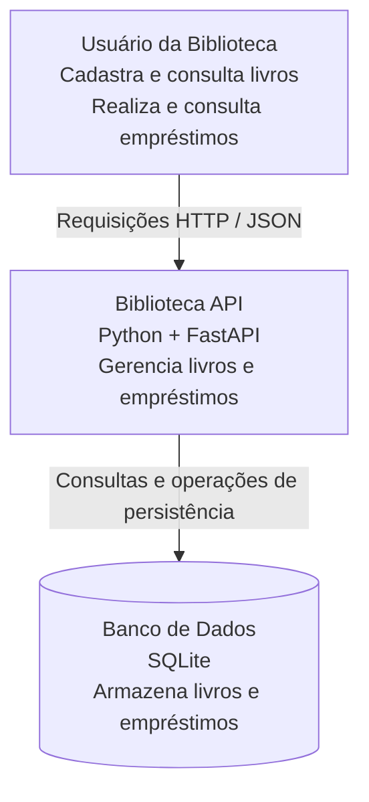

# C4 — Diagrama de Contexto
## Biblioteca API

### 1. Objetivo

Representar o sistema Biblioteca API e sua interação com os usuários e os componentes externos necessários ao seu funcionamento.

### 2. Diagrama

### 3. Elementos do sistema

| Elemento | Responsabilidade |
|---|---|
| Usuário da Biblioteca | Interagir com a API para consultar livros e realizar empréstimos |
| Biblioteca API | Receber requisições, validar dados e executar as regras de negócio |
| SQLite | Armazenar os dados dos livros e empréstimos |

### 4. Limites do sistema

A Biblioteca API é responsável pelo gerenciamento de livros e empréstimos. O banco SQLite é utilizado como mecanismo de persistência.

A aplicação é disponibilizada por meio de endpoints HTTP e utiliza JSON para comunicação.

### 5. Escopo

O diagrama representa a visão geral do sistema, sem detalhar componentes internos, classes ou operações específicas.